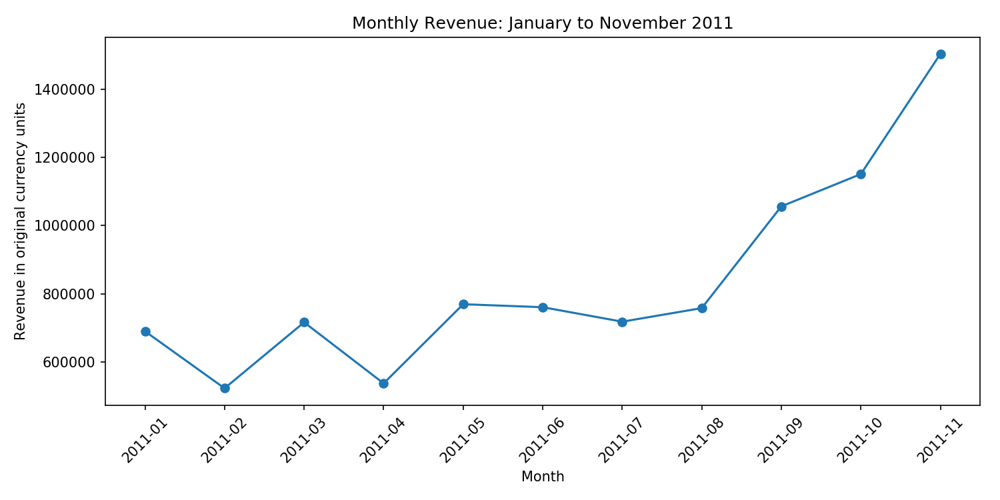
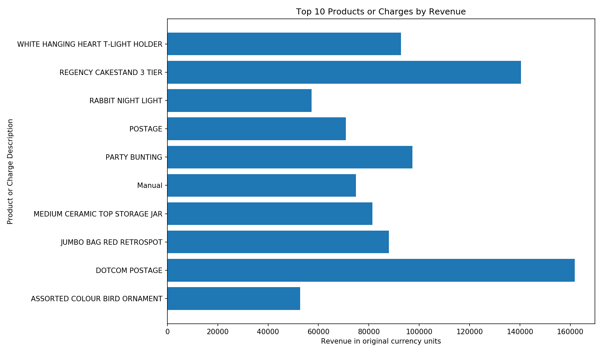
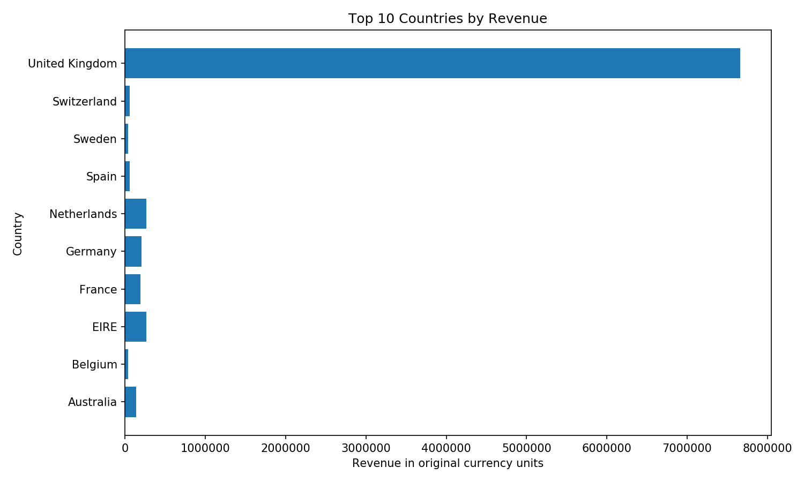

# Online Retail Sales Analysis

## Project Overview

This personal project analyses online retail transaction data to understand sales trends, product performance and geographic revenue distribution.

## Business Questions

1. How did revenue change over time?
2. Which products generated the highest revenue?
3. Which countries generated the highest revenue?
4. What business recommendations can be developed from the findings?

## Data Source

UCI Machine Learning Repository: Online Retail dataset.

The original dataset is not modified. Data-cleaning decisions will be documented in the analysis notebook.

## Tools

- Python
- pandas
- Matplotlib
- Jupyter Notebook

## Key Findings

- The highest-revenue month was November 2011.
- The lowest-revenue month was February 2011.
- The highest-revenue product or charge description was DOTCOM POSTAGE.
- The United Kingdom accounted for 83.46% of sales value during the analysis period.

## Visualisations

## Business Recommendations

1. Investigate the drivers of revenue changes in the highest- and lowest-revenue months before making inventory or campaign decisions.
2. Review the contribution of leading products or charge descriptions, while recognising that sales value does not represent profitability.
3. Given the concentration of sales in the United Kingdom, further assess geographic dependence and the feasibility of developing other markets.
## Limitations

- The analysis covers January to November 2011.
- Cancelled and non-positive transactions were excluded under the documented cleaning rules.
- Revenue represents sales value after these cleaning steps, not net revenue or profit.
- Product descriptions may include charges or services rather than physical products.
- The analysis identifies patterns but does not establish their causes.
## How to Run

1. Download the Online Retail dataset from the UCI Machine Learning Repository.
2. Place the original Excel file in the local data folder.
3. Open `retail_sales_analysis.ipynb` in Jupyter Notebook.
4. Run the cells in order.

The original and cleaned full datasets are not included in this repository.
